<p align="center">
  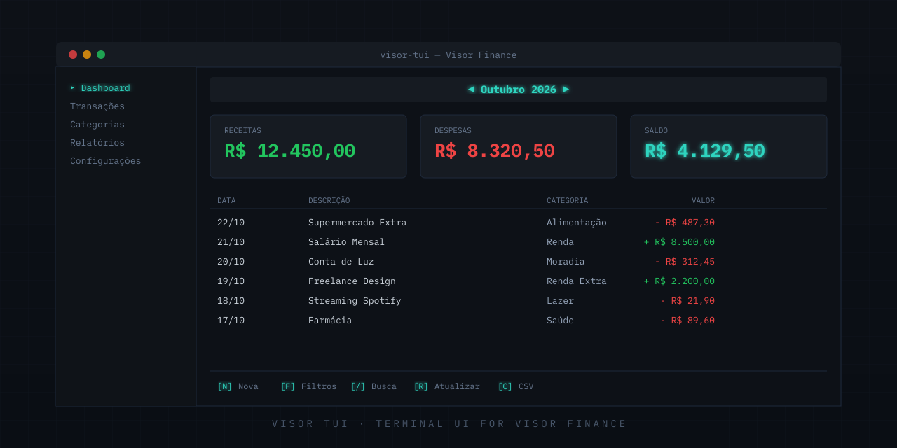
</p>

# visor-tui

Terminal UI for [Visor Finance](https://visorfinance.app) personal API.

Built with [HQTUI](https://hqtui.com). Mirrors every feature of the official [visor-cli](https://github.com/Visor-Finance/visor-cli).

## Screenshots

> Sample data only — not a real account.

<table>
  <tr>
    <td align="center" width="50%">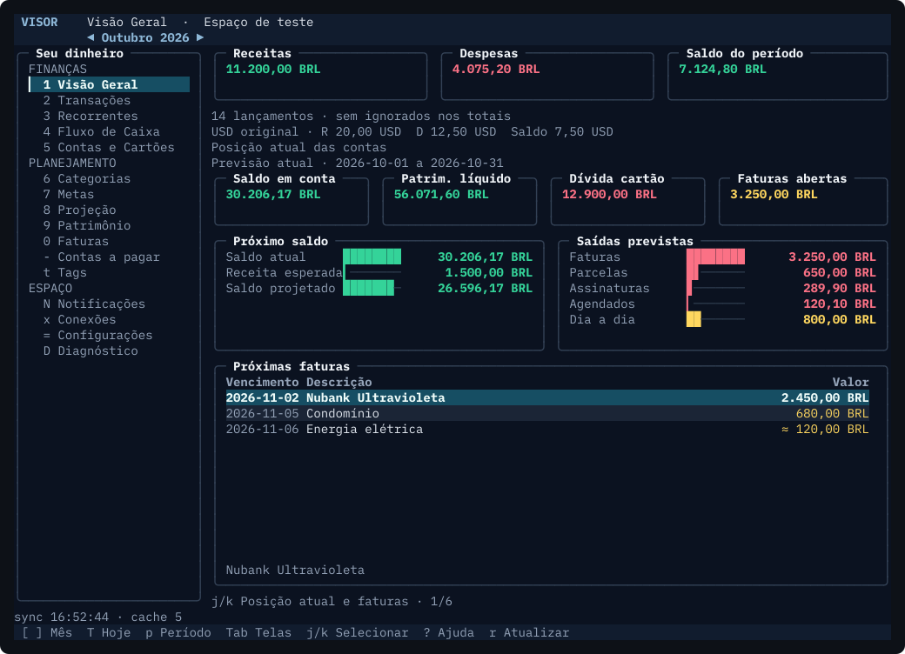<br/><sub>Visão Geral</sub></td>
    <td align="center" width="50%">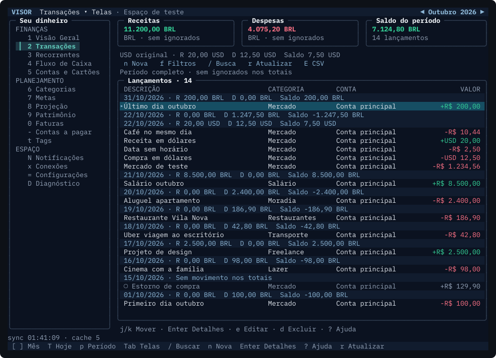<br/><sub>Transações</sub></td>
  </tr>
  <tr>
    <td align="center">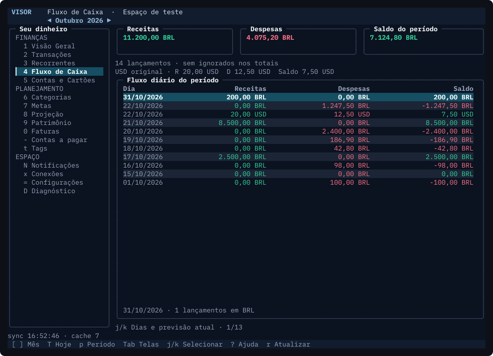<br/><sub>Fluxo de Caixa</sub></td>
    <td align="center">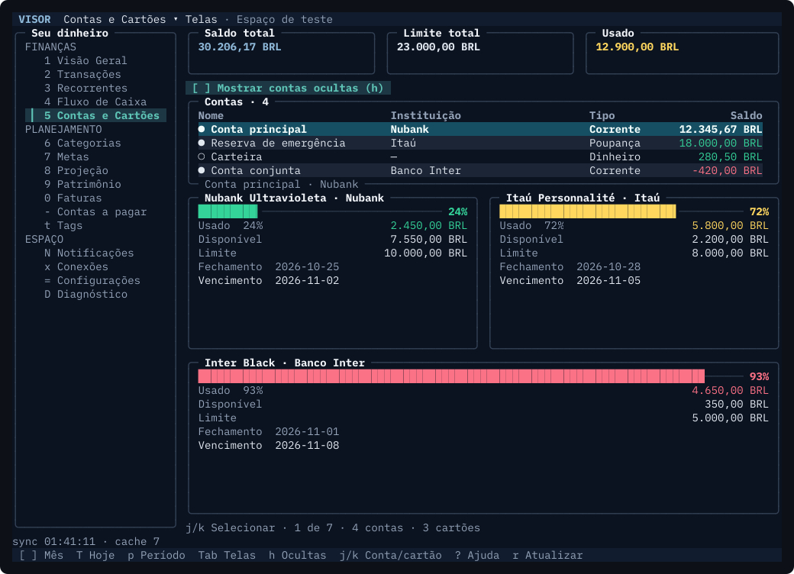<br/><sub>Contas e Cartões</sub></td>
  </tr>
  <tr>
    <td align="center">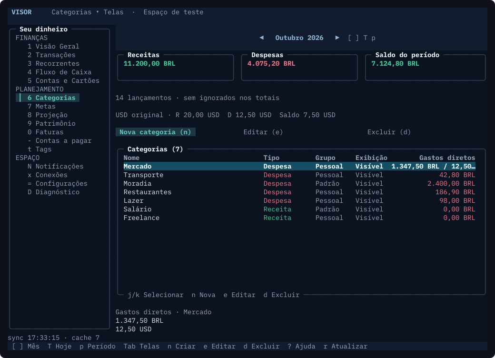<br/><sub>Categorias</sub></td>
    <td align="center">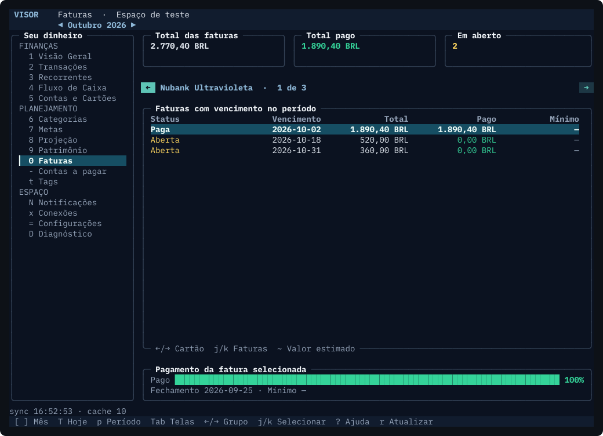<br/><sub>Faturas</sub></td>
  </tr>
  <tr>
    <td align="center">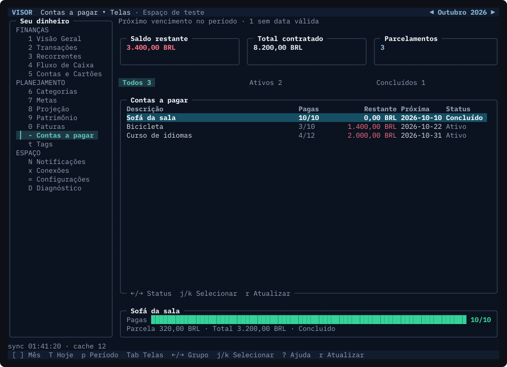<br/><sub>Contas a pagar</sub></td>
    <td align="center">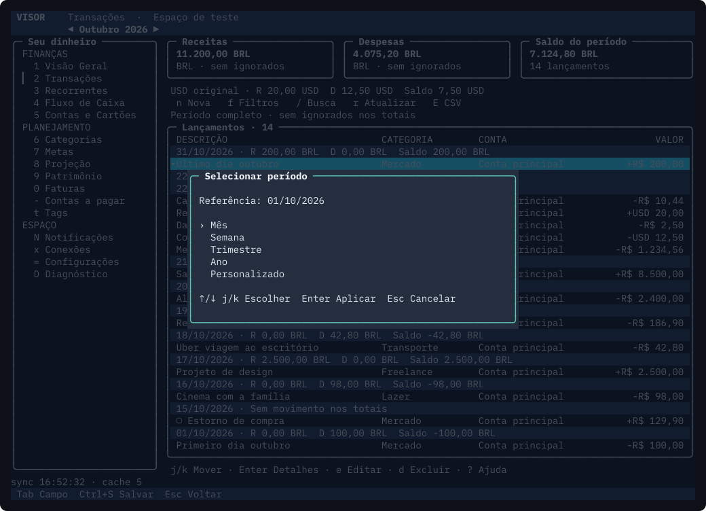<br/><sub>Seletor de período</sub></td>
  </tr>
</table>

<details>
<summary>Terminal 80×24 (compact)</summary>
<br/>
<table>
  <tr>
    <td align="center" width="50%">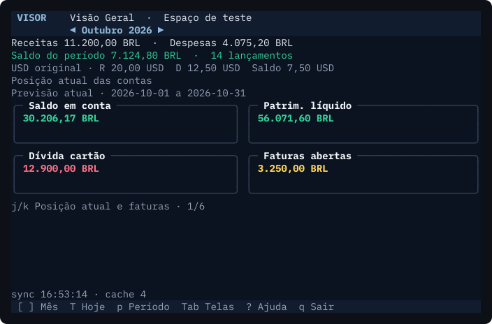<br/><sub>Visão Geral</sub></td>
    <td align="center" width="50%">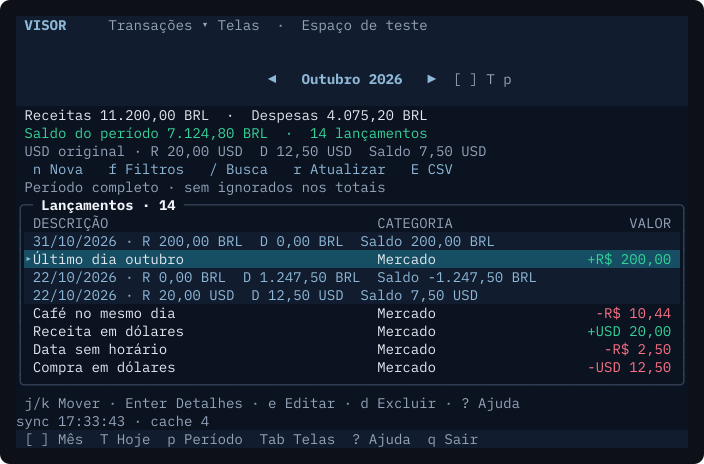<br/><sub>Transações</sub></td>
  </tr>
  <tr>
    <td align="center">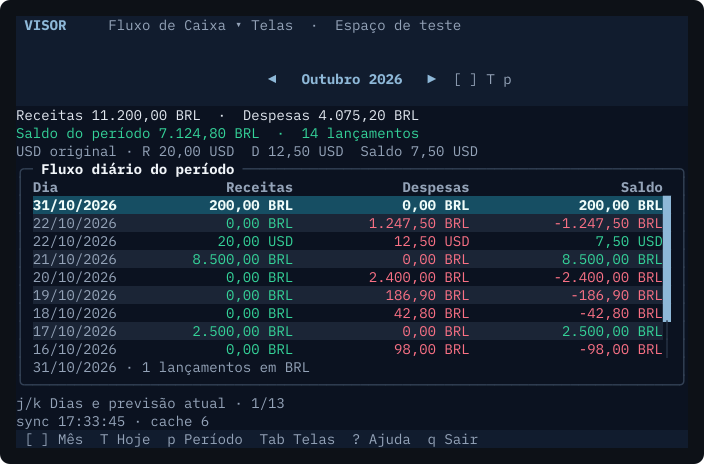<br/><sub>Fluxo de Caixa</sub></td>
    <td align="center">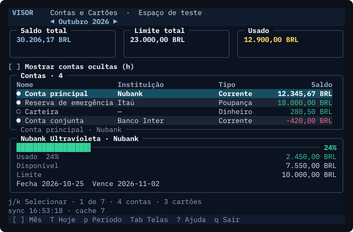<br/><sub>Contas e Cartões</sub></td>
  </tr>
  <tr>
    <td align="center">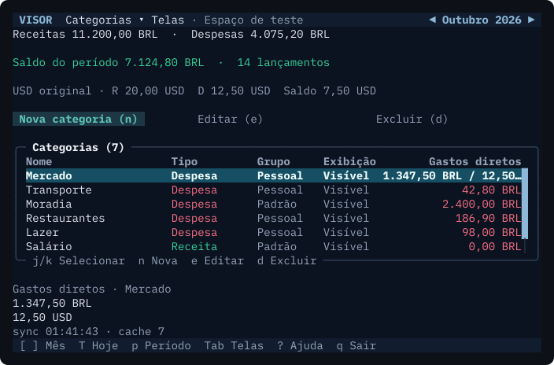<br/><sub>Categorias</sub></td>
    <td align="center">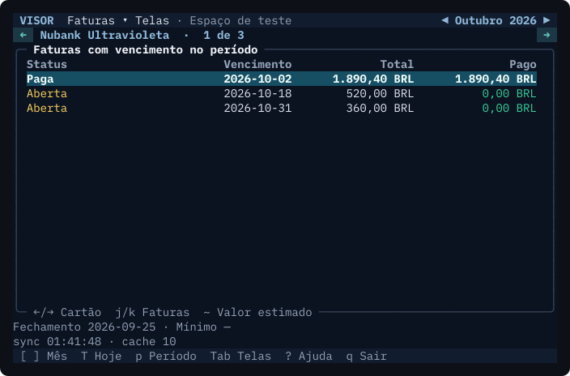<br/><sub>Faturas</sub></td>
  </tr>
  <tr>
    <td align="center">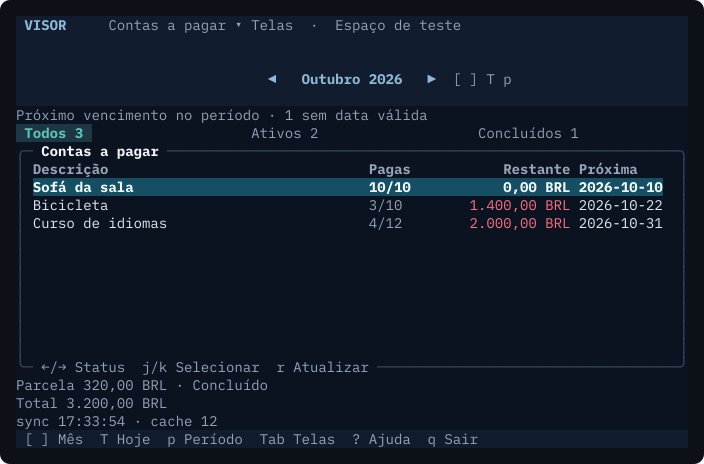<br/><sub>Contas a pagar</sub></td>
    <td align="center">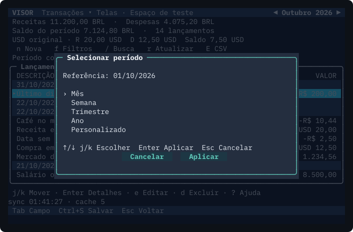<br/><sub>Seletor de período</sub></td>
  </tr>
</table>
</details>

## Install

```bash
cargo install --path .
```

Or build from source:

```bash
cargo build --release
./target/release/visor-tui
```

## Authentication

The TUI shares credentials with `visor-cli`. If you are already logged in via the CLI, the TUI will use the same token automatically.

### Personal API Token

Create a token at **Settings → Connected Apps** in the Visor dashboard, then:

```bash
# Option 1: environment variable (takes precedence over stored credentials)
export VISOR_TOKEN=visor_pat_...

# Option 2: let the TUI prompt on first launch
visor-tui
```

### OAuth (CLI login)

If you previously ran `visor auth login`, the TUI reuses that credential from your OS keyring or file store.

### Environment Variables

| Variable | Purpose |
|---|---|
| `VISOR_TOKEN` | Override stored credential with a personal API token |
| `VISOR_SPACE` | Override the active space (name or UUID) |
| `VISOR_API_URL` | Override the API base URL (default: `https://api.visorfinance.app`) |
| `VISOR_AUTH_URL` | Override the OAuth authorization server URL |
| `VISOR_CONFIG_DIR` | Override config directory location |
| `VISOR_CREDENTIAL_STORE` | `keyring` (default) or `file` |
| `VISOR_DEBUG` | Enable HTTP request logging |
| `NO_COLOR` | Disable ANSI colors |

Config directory resolution order:

1. `$VISOR_CONFIG_DIR`
2. `$XDG_CONFIG_HOME/visor`
3. `~/.config/visor`

## Usage

```bash
visor-tui
```

Navigate with arrow keys or Tab. Press `?` for keyboard shortcuts.
See [UX.md](UX.md) for the full keymap, transaction forms, filters, and mock verification.

## License

MIT — see [LICENSE](LICENSE).
